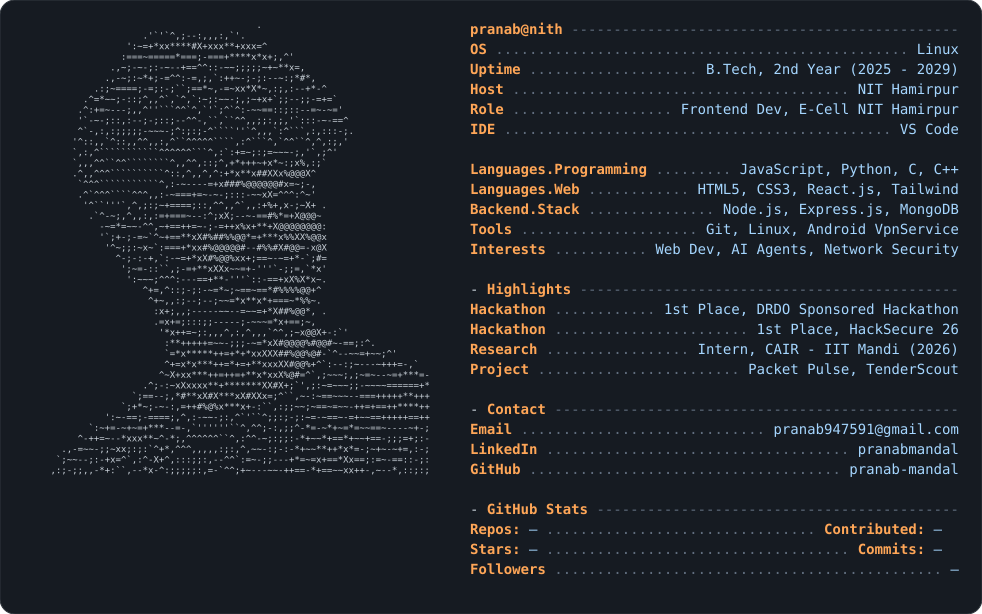

  <a href="https://github.com/pranab-mandal">
    <picture>
      <source media="(prefers-color-scheme: dark)"  srcset="dark_mode.svg">
      <source media="(prefers-color-scheme: light)" srcset="light_mode.svg">
      
    </picture>
  </a>

 

### 🛠 Tech I use

### 📫 Reach me

